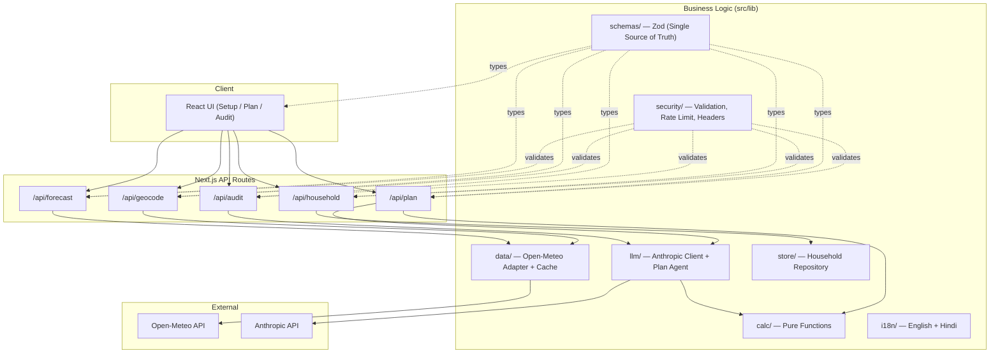
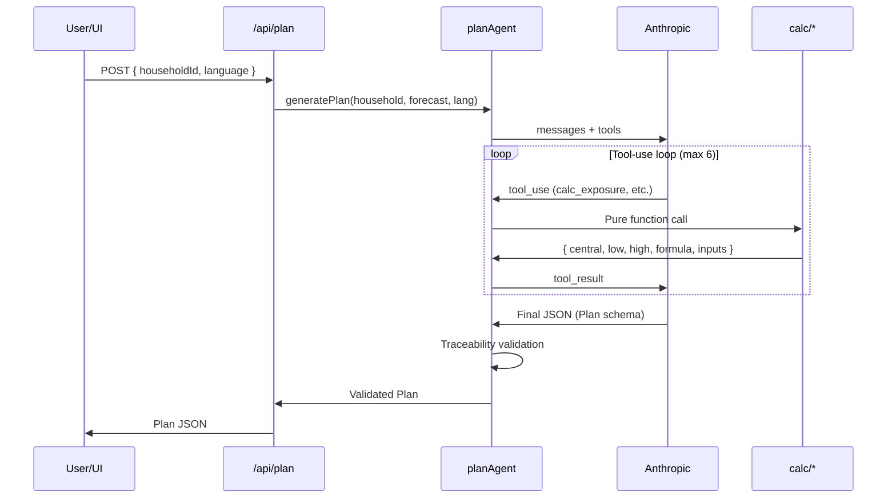

# Architecture

> To be completed in Phase 1-2.

## Overview

AirPlan is an Urban Air Quality Assistant built with Next.js (App Router) + TypeScript.

## Architecture Diagram

## Planning Sequence

## Architecture Decision Records

### ADR-1: Deterministic Calc Layer vs LLM Numbers

**Decision:** All numerical results come from a pure, unit-tested calculation layer. The LLM never invents numbers.

**Rationale:** LLMs hallucinate numerical values. For health-related exposure calculations, accuracy and reproducibility are critical. A deterministic layer enables unit testing, property-based testing, and traceability from every displayed number to a function call.

**Consequence:** The LLM must use tool calls to get any number. A traceability validator rejects plans with untraceable numbers.

### ADR-2: Direct Anthropic SDK vs Agent Framework

**Decision:** Use `@anthropic-ai/sdk` directly with tool-use, no agent framework.

**Rationale:** Minimal dependencies, full control over the tool-use loop, prompt caching, and token budgets. Frameworks add abstraction that makes debugging and cost control harder at hackathon speed.

### ADR-3: JSON File Store Behind Repository Interface

**Decision:** A `HouseholdRepository` interface with a JSON-file implementation, allowing future PostgreSQL swap.

**Rationale:** No database setup needed to run. The repository pattern isolates storage from business logic. The interface is documented so a PostgreSQL implementation can be added without changing any consumer.
