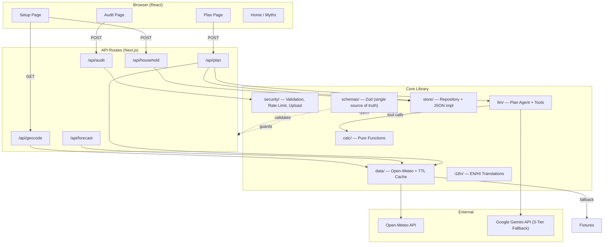
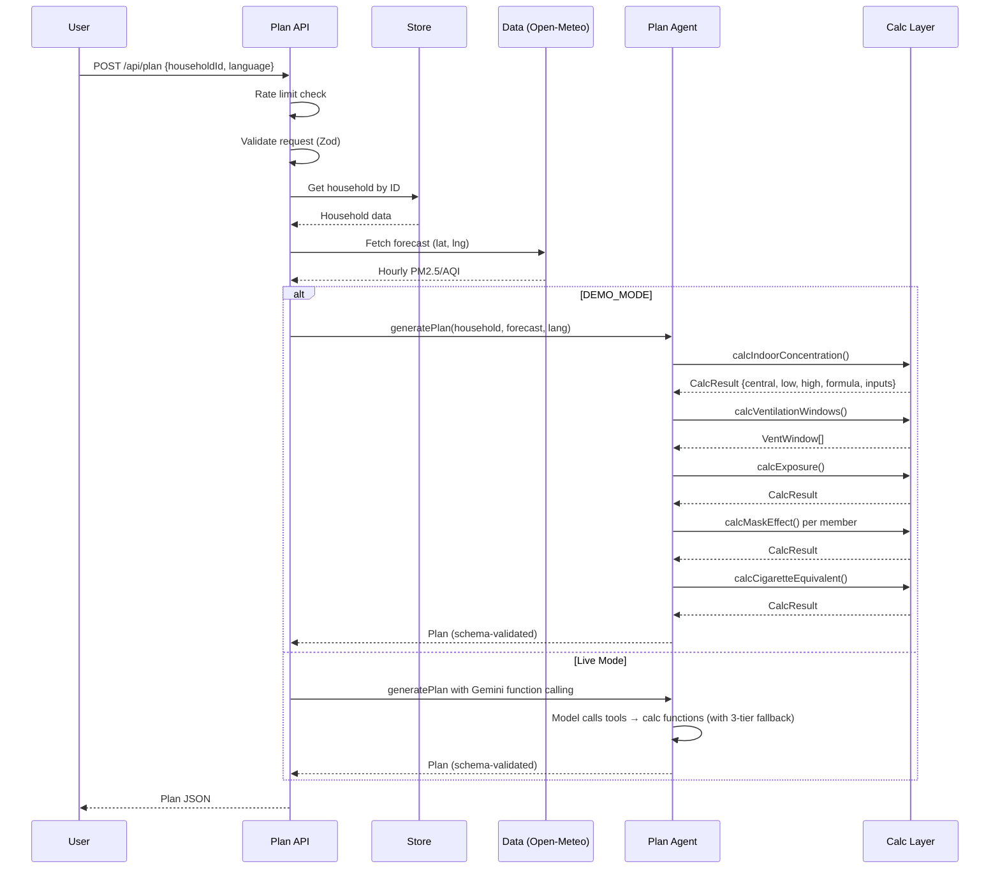

# AirPlan — Architecture

## Overview

AirPlan is a Next.js App Router application that generates personalized air quality action plans for families during winter smog. The system is designed around a **deterministic calculation layer** — the LLM never invents numbers.

## Component Diagram

## Planning Sequence

## Architecture Decision Records

### ADR-1: Deterministic Calc Layer vs LLM Numbers

**Decision:** All exposure, mask, indoor, and cigarette-equivalent calculations use pure, deterministic functions. The LLM only selects which actions to recommend and explains results in plain language.

**Rationale:** LLMs hallucinate numbers. For health-related exposure calculations, every number must be verifiable and reproducible. The calc layer is unit-tested with hand-calculated examples and property-based invariants (e.g., "better mask never increases exposure").

**Consequence:** The LLM uses tool calling to invoke calc functions. Every number on an impact card traces to a CalcResult with its formula and inputs.

### ADR-2: Direct Google Gemini REST Client & 3-Tier Fallback vs Heavy Agent Framework

**Decision:** Use a lightweight direct REST client for the Google Gemini API (`gemini-3.8-flash` primary → `gemini-2.5-flash` → `gemini-3.5-flash-lite` fallbacks) instead of heavy agent frameworks like LangChain or external SDK wrappers.

**Rationale:** The planning flow requires strict latency and zero bundle bloat. External multi-megabyte agent frameworks introduce breaking changes, cold start overhead, and unnecessary abstraction layers. A native fetch client provides 100% control over abort signals, payload formats, and automated 3-tier failover on HTTP 429 (rate limits) or 503 (high demand spikes).

**Consequence:** Zero external SDK runtime dependencies. Automatic failover guarantees seamless continuity. In DEMO_MODE, the planner runs fully offline and deterministically without network calls.

### ADR-3: JSON File Store Behind Repository Interface

**Decision:** Persist household data in a JSON file, accessed through a `HouseholdRepository` interface.

**Rationale:** No database setup required to run. The interface allows swapping to PostgreSQL or any other store without changing API routes. For a hackathon MVP, file-based storage is sufficient and simplifies the demo experience.

**Consequence:** `JsonHouseholdStore` reads/writes `data/households.json`. The `HouseholdRepository` interface in `repository.ts` defines `get`, `save`, `delete`, `list` methods that any implementation must provide.
